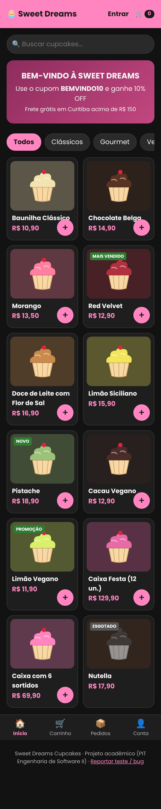

# Sweet Dreams Cupcakes

Aplicativo web (mobile-first) de e-commerce para uma confeitaria de cupcakes gourmet: vitrine virtual, carrinho, cupom de desconto, cálculo de frete, pagamento com cartão ou PIX, acompanhamento do pedido, painel administrativo e painel do entregador.

> **Projeto Integrador Transdisciplinar em Engenharia de Software II** - Universidade Positivo (EAD)
> Aluno: **Guilherme Dudu Berti** · RGM 48103373
> Continuação do planejamento feito no PIT I (requisitos ágeis, UML e protótipos).



## Tecnologias

| Camada | Tecnologia | Por quê |
|---|---|---|
| Back-end | **Python 3.10+ / Flask 3** | Linguagem sugerida na disciplina, simples de instalar e ler |
| Arquitetura | **MVC** (Model / View / Controller) + Services | Padrão indicado no material da disciplina |
| Banco de dados | **SQLite 3** | SGBD relacional mais usado do mundo, não exige servidor; o script SQL é portável para PostgreSQL/MySQL |
| Front-end | **HTML5 + CSS3 + JavaScript** puro (templates Jinja2) | Exigência da Situação-Problema 2; sem frameworks pesados |
| Testes | **pytest** (83 testes: unitários, integração e sistema) | Ferramenta indicada no material |

## Como rodar (Windows, macOS ou Linux)

Pré-requisito: [Python 3.10 ou superior](https://www.python.org/downloads/) (no Windows, marque *"Add Python to PATH"* na instalação).

```bash
# 1. Baixe o projeto
git clone https://github.com/Guiberti/sweet-dreams-cupcakes.git
cd sweet-dreams-cupcakes

# 2. Instale as dependências
pip install -r requirements.txt

# 3. Rode o app (o banco é criado sozinho na primeira vez)
python run.py
```

Abra **http://localhost:5000**. O terminal também mostra o endereço para abrir **no celular** (mesma rede Wi-Fi), por exemplo `http://192.168.0.10:5000`.

Para recriar o banco do zero com os dados de demonstração: `flask --app run init-db`

### Contas de demonstração

| Perfil | E-mail | Senha |
|---|---|---|
| Cliente | `cliente@teste.com` | `Cliente@123` |
| Administrador | `admin@sweetdreams.com` | `Admin@123` |
| Entregador | `entregador@sweetdreams.com` | `Entrega@123` |

### Dados para testar

| O quê | Valor |
|---|---|
| Cartão aprovado | `4111 1111 1111 1111` · validade futura (ex.: `12/30`) · CVV `123` |
| Cartão recusado | `4000 0000 0000 0002` |
| Cupom 10% | `BEMVINDO10` |
| Cupom R$ 15 (mínimo R$ 80) | `DOCE15` |
| Cupom expirado | `EXPIRADO` |
| CEP com entrega | `80010-000` (Curitiba) ou `83005-000` (Região Metropolitana) |
| CEP fora da área | `01310-100` (São Paulo) |
| Produto esgotado | Nutella |

## Rodar os testes

```bash
python -m pytest -v
```

Resultado atual: **83 testes, 100% aprovados** (53 unitários, 10 de integração, 20 de sistema). Relatório completo em [`docs/situacao-3-testes-validacao`](docs/situacao-3-testes-validacao/README.md).

## Funcionalidades implementadas (backlog do PIT I)

| HU | História | Status |
|---|---|---|
| 001 | Cadastro de novo cliente (validação de e-mail, senha forte, aceite LGPD) | Implementado |
| 002 | Login / logout com perfis (cliente, admin, entregador) | Implementado |
| 003 | Navegar no catálogo (categorias, busca, selos, esgotados) | Implementado |
| 004 | Detalhe do produto (descrição, calorias, estoque, relacionados) | Implementado |
| 005/006 | Adicionar e gerenciar carrinho (quantidade, remover, limite de estoque) | Implementado |
| 007 | Aplicar cupom de desconto (validade, mínimo, quantidade) | Implementado |
| 008 | Calcular frete por CEP (área de entrega, frete grátis ≥ R$ 150, retirada) | Implementado |
| 009 | Finalizar pedido (transação com baixa de estoque) | Implementado |
| 010 | Pagamento com cartão (Luhn, validade, CVV, aprovação/recusa) | Implementado (simulado) |
| 011 | Pagamento com PIX (copia e cola) | Implementado (simulado) |
| 012 | Acompanhar pedido (linha do tempo de status) | Implementado |
| 013 | Histórico de pedidos | Implementado |
| 015 | Gerenciar endereços | Implementado |
| 018 | Admin: CRUD de produtos | Implementado |
| 019 | Admin: gerenciar pedidos e status | Implementado |
| 020 | Admin: dashboard de vendas | Implementado |
| 021 | Admin: gerenciar cupons | Implementado |
| 022 | Admin: atribuir entregador | Implementado |
| - | Entregador: ver entregas e atualizar status | Implementado |
| - | Formulário de laudo para testadores (`/teste`) | Implementado |
| 014/016/017 | Avaliar produto, favoritos, notificações push | Próximas versões (prioridade C/D no backlog) |

## Estrutura do repositório

```
sweet-dreams-cupcakes/
├── app/
│   ├── models/          # MODEL: entidades e acesso ao banco
│   ├── controllers/     # CONTROLLER: rotas Flask (Blueprints)
│   ├── services/        # Regras de negócio puras (frete, pagamento, validações)
│   ├── templates/       # VIEW: páginas HTML (Jinja2)
│   └── static/          # CSS, JavaScript e uploads
├── database/
│   ├── schema.sql       # Projeto físico do banco (DDL)
│   └── seed.sql         # Dados iniciais
├── tests/               # pytest: unitários, integração e sistema
├── docs/
│   ├── situacao-1-planejamento/     # Revisão do PIT I, modelo de dados, dicionário
│   ├── situacao-2-desenvolvimento/  # Arquitetura, decisões técnicas
│   ├── situacao-3-testes-validacao/ # Plano e relatório de testes, laudos, vídeo
│   ├── diagramas/       # UML, DER, arquitetura (PNG + fontes .dot)
│   ├── screenshots/     # Telas do sistema
│   └── manual-de-uso.md
├── run.py
└── requirements.txt
```

## Documentação

- [Manual de uso](docs/manual-de-uso.md)
- [Situação 1 - Revisão do planejamento e banco de dados](docs/situacao-1-planejamento/README.md)
- [Situação 2 - Desenvolvimento](docs/situacao-2-desenvolvimento/README.md)
- [Situação 3 - Testes e validação](docs/situacao-3-testes-validacao/README.md)

## Limitações conhecidas

- O **pagamento é simulado**: nenhum gateway real é chamado e nenhum dado de cartão é armazenado (só os 4 últimos dígitos).
- Não há proteção **CSRF** nos formulários (seria adicionada com Flask-WTF antes de ir para produção).
- O servidor embutido do Flask é para desenvolvimento; em produção usaríamos Gunicorn/Waitress atrás de HTTPS.
