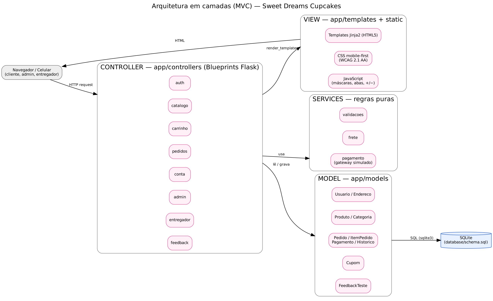

# Situação-Problema 2 - Desenvolvimento

## Stack

| Item | Escolha |
|---|---|
| Linguagem back-end | Python 3.10+ |
| Framework | Flask 3 (Blueprints) |
| Padrão de projeto | **MVC** + camada de Services; Application Factory (`create_app`) |
| Banco | SQLite 3 via módulo `sqlite3` (SQL explícito, sem ORM - o aluno vê o SQL que roda) |
| Front-end | HTML5 (Jinja2), CSS3 mobile-first, JavaScript puro |
| Testes | pytest |
| Versionamento | Git + GitHub |

## Arquitetura



| Camada | Pasta | Responsabilidade |
|---|---|---|
| **Model** | `app/models/` | Entidades (`Usuario`, `Endereco`, `Produto`, `Categoria`, `Cupom`, `Pedido`, `Pagamento`, `FeedbackTeste`), SQL e regras que dependem do banco (baixa de estoque, máquina de estados) |
| **View** | `app/templates/`, `app/static/` | Páginas HTML, CSS e JS. Não contém regra de negócio |
| **Controller** | `app/controllers/` | Um Blueprint por área: `auth`, `catalogo`, `carrinho`, `pedidos`, `conta`, `admin`, `entregador`, `feedback`. Recebe a requisição, chama Model/Services, escolhe a View |
| **Services** | `app/services/` | Regras puras, sem banco: `validacoes`, `frete`, `pagamento`. Por serem puras, são as mais testadas (testes unitários) |

## Decisões técnicas importantes

| Decisão | Por quê |
|---|---|
| Pedido criado em **uma transação** (`commit`/`rollback`) | Se um item não tiver estoque, nada é gravado: nem pedido, nem baixa parcial |
| **Preço congelado** no item do pedido | Mudar o preço do produto depois não altera pedidos antigos |
| **Máquina de estados** do pedido no Model | Impede, por exemplo, marcar como "Entregue" um pedido não pago; vale para admin e entregador |
| **Exclusão lógica** de produtos (`ativo = 0`) | Produto vendido não pode sumir do histórico |
| Senhas com **hash** (`werkzeug.security`) | Nunca guardar senha pura (RNF-001 do PIT I) |
| Cartão: só **4 últimos dígitos** | Princípio PCI-DSS: o sistema não guarda dado sensível de cartão |
| Carrinho na **sessão** | Visitante monta o carrinho sem conta; o carrinho é preservado no login |
| Controle de acesso por **perfil** (`@login_obrigatorio("ADMIN")`) | Cliente recebe 403 ao tentar abrir /admin; cliente não vê pedido de outro cliente |
| **Melhoria progressiva** no JS | Tudo funciona sem JavaScript; o JS só acrescenta máscaras, botões +/−, abas e cópia do PIX |
| Upload de print com **whitelist de extensões** e limite de 5 MB | Segurança do formulário de laudo |

## Tratamento de erros

- Validação no servidor para **todos** os formulários (o front nunca é confiável), com mensagens em português.
- Exceções de domínio específicas: `PedidoInvalido`, `CupomInvalido`, `PagamentoInvalido`, `EmailJaCadastrado`, `ForaDaAreaDeEntrega`.
- Páginas de erro próprias: 403, 404, 413 (arquivo grande) e 500.

## Telas

As 23 capturas estão em [`docs/screenshots`](../screenshots/). Principais fluxos:

| Cliente | Admin | Entregador |
|---|---|---|
| Home, detalhe, carrinho com cupom, checkout (entrega e retirada), pagamento cartão (aprovado e recusado), PIX, acompanhar pedido, meus pedidos, conta | Dashboard, pedido (status + entregador), produtos, formulário de produto, cupons, laudos | Minhas entregas, em rota |

## Como o código está organizado no Git

```
app/        código-fonte (MVC)
database/   DDL e carga inicial
tests/      testes automatizados
docs/       documentação de cada situação-problema, diagramas e telas
```
